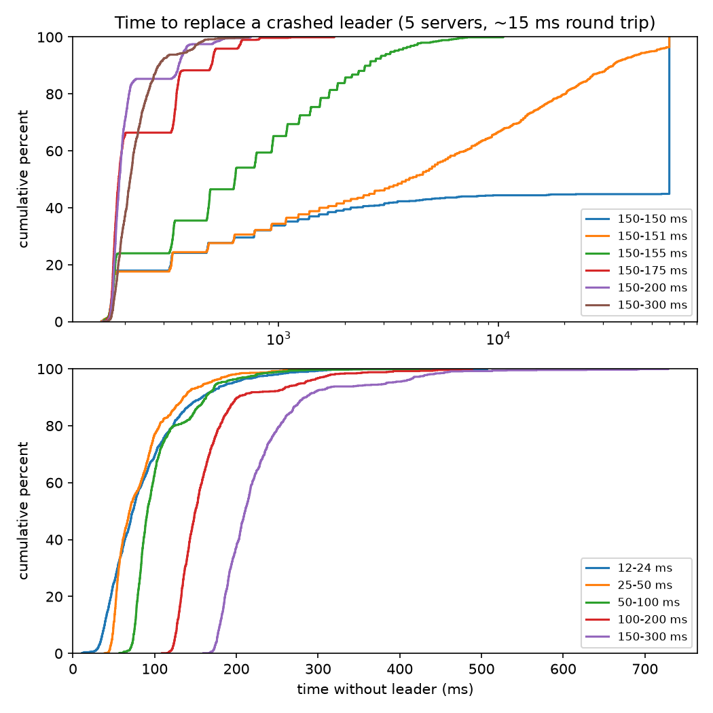
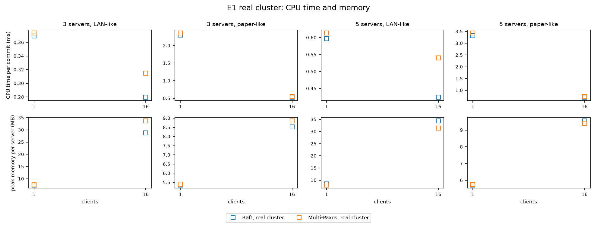
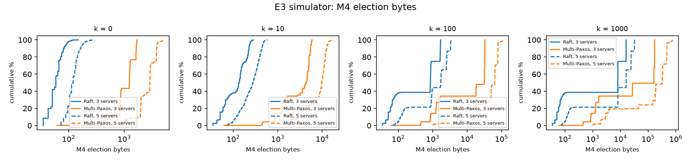
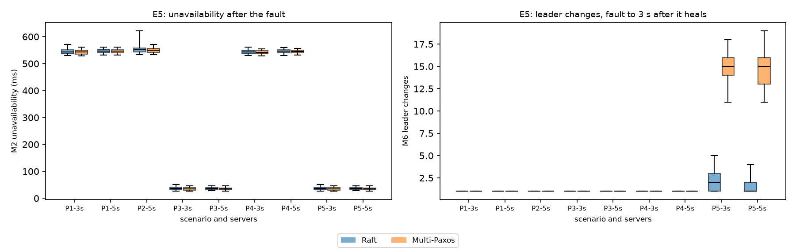
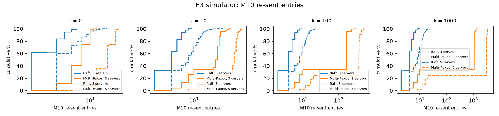
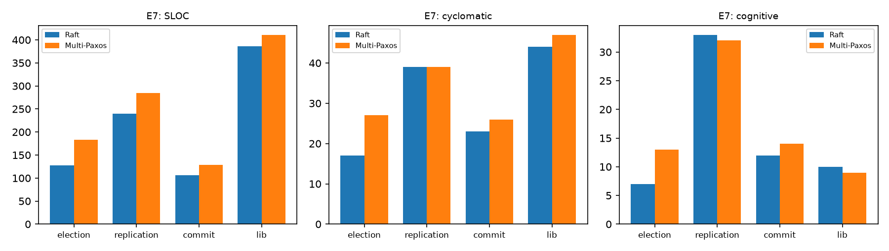

# Raft vs. Multi-Paxos on a Vector Store Control Plane

**ECE 382N Distributed Systems, Fall 2026: Final Report**

**Siddak Bhatia (sb56878), Harrison Held (HWH492)**

> **Status:** complete. Every number comes from `docs/RESULTS.md`, and every figure from
> `cargo xtask figures`.

## Abstract

We built the control plane of a sharded, replicated vector store twice, once on Raft and
once on Multi-Paxos, in Rust. The two builds share every line of code except the
consensus module: the driver, storage, network transport, state machine, leases, data
plane, clients, simulator, model checker, and experiment runner are common. This lets us
test three claims from the Raft paper (Ongaro and Ousterhout, 2014) with the algorithm as
the only variable: that Raft is as efficient as Paxos, that it separates leader election,
log replication, and safety, and that its stronger coherency reduces the number of states
to consider. The research questions, metrics, experiments, sample sizes, and statistical
tests were fixed in a research protocol before any data was collected, and every later
change is recorded as a dated amendment.

In steady state the two were equivalent within ±5% with 1, 4, and 64 commands in flight,
but not with 16: there Multi-Paxos was up to 11% faster, and Raft's followers rejected
about one out-of-order message per commit. With 16 or more clients Raft synced storage
less often (1.2–2.3 times per commit against 3.0–5.1), and on the real cluster with 16
clients Multi-Paxos used 4–27% more CPU time per commit, but Raft sent 2.7–5.6 times the
network bytes. Under a fixed offered load Raft kept up with at most 8,000 commands per
second on 3 servers and 6,000 on 5, against at least 10,000 for Multi-Paxos, and its
cluster stalled, committing nothing for 10 s, in 44 of 360 trials against 4. After a leader
failure, Raft re-sent 15–64 times fewer entries, but its election restriction cost extra
rounds, so Multi-Paxos had a leader 2–11% sooner in the simulator; on a flapping link the
same restriction kept Raft stable while Multi-Paxos changed leaders a median of 15 times.
Raft's logs never had gaps and its implementation is smaller, but at the one
model-checking bound both algorithms completed, Multi-Paxos reached 3.7% fewer states.
Shard recovery in the vector store took 3.4–5.6 s under both, set by its lease. No safety
check failed in any trial of either algorithm.

## 1. Background

A vector store answers nearest-neighbor queries over embeddings. Once a collection is too
large for one machine it is split into shards on several data nodes, and something must
track which collections exist, which data nodes are alive, and which nodes hold each
shard. That coordinator is a single point of failure, so we replicate it on 3 or 5
servers with a consensus algorithm. Only this metadata goes through consensus; vectors go
from clients straight to the data nodes, where each shard is replicated from a primary to
its backups, as in Kafka's in-sync replica model.

Raft and Multi-Paxos both replicate a log through a leader, and with a stable leader both
commit an entry in one round trip to a majority. Howard and Mortier (2020) describe Paxos
in Raft's terms and argue that the two differ mainly in leader election: a Raft candidate
must already hold every committed entry, while any Paxos server may become leader and then
learns the uncommitted suffix from a majority's promises and re-proposes it. Our
Multi-Paxos variant follows that description, with remaining details from van Renesse and
Altinbuken (2015). Its exact rules are in `docs/PAXOS_SPEC.md`, written in the style of
Raft's Figure 2 and frozen before coding.

The Raft paper makes three claims that this project tests:

1. **Efficiency.** Raft is as efficient as Paxos.
2. **Decomposition.** Raft separates leader election, log replication, and safety.
3. **Coherency.** Raft's stronger rules, that logs never have gaps and entries flow only
   from leader to followers, reduce the number of states to consider.

The six research questions (`docs/PLAN.md` §2):

| ID | Question | Hypothesis |
|---|---|---|
| RQ1 | Do the algorithms differ in commit latency or throughput with a stable leader? | No: equivalent within ±5% |
| RQ2 | How do they differ when the leader fails? | Multi-Paxos election traffic grows with the number of uncommitted entries and Raft's does not; which recovers faster is open |
| RQ3 | Does a new Raft leader re-send fewer log entries? | Yes |
| RQ4 | Does Raft keep logs more coherent and reach fewer states? | Yes: fewer reachable states, no log gaps, no entries sent toward a leader |
| RQ5 | Is Raft's implementation smaller? | Yes: fewer message types and lower code complexity |
| RQ6 | Does the algorithm change how fast the vector store recovers? | Only when the control-plane leader fails at the same time |

## 2. System

### 2.1 One codebase, two algorithms

Both algorithms implement one trait, `consensus::Consensus`. An implementation performs no
I/O, never reads the clock, and draws random numbers only from a seeded generator. A
*driver* delivers one input at a time (a message, a timer, a proposal, or a leadership
check), calls `Storage::sync` after the input, and only then carries out the outputs
(messages, timers, applied entries). Three drivers run the same algorithm code:

- the deterministic **simulator**, which runs a cluster on a virtual clock with seeded
  message delays, loss, duplication, partitions, and crashes, and checks safety after every
  step;
- the **model checker**, which explores every interleaving within fixed bounds with
  Stateright;
- the **server**, which runs the algorithm on its own OS thread with fsync-backed storage
  and a gRPC transport.

Only `crates/raft` and `crates/paxos` differ. Messages, bytes, fsyncs, and timings are
counted in shared code. `cargo xtask check-repo` enforces the separation: only the server
and the experiment runner may depend on an algorithm crate, and the consensus, algorithm,
simulator, and model-checking crates may not use I/O libraries.

### 2.2 The algorithms

**Raft** follows Figure 2 of the paper, with a no-op entry on election and leader-confirmed
reads (§8). Two details beyond Figure 2 are recorded in `docs/RESEARCH.md` amendment A1.
The first is flow control as in etcd's Raft library: the leader probes a follower one
message at a time until their logs match, then sends entries ahead of acknowledgments up to
an in-flight limit. The second is a round number on heartbeats, used for leadership
confirmation. The term-based log backtracking of §5.3 is disabled, as are PreVote,
CheckQuorum, and read leases.

**Multi-Paxos** (`docs/PAXOS_SPEC.md`): each term belongs to one server (term `t` to the
server of rank `t mod N`), so each term has at most one candidate. A candidate moves to its
next own term and sends `Prepare` with its commit index; each voter that promises returns
every entry above that index. With a majority of promises, the new leader keeps the
highest-term entry at each index, fills missing indexes with no-ops, re-proposes all of
them in its own term, and appends a no-op. Followers accept each index on its own, so their
logs can have gaps; a follower commits an index it holds in the leader's term once the
leader's commit index passes it, and a follower missing chosen entries receives them in a
`Commit` message, at most one unanswered per follower.

Both algorithms take the same `Config`: election timeouts of 150–300 ms, a 75 ms heartbeat,
at most 64 entries per message, and at most 1,024 unacknowledged entries per follower. Both
append a no-op on election and confirm leadership the same way: the leader sends a round of
heartbeats and confirms once a majority has answered it.

### 2.3 The control plane

The state machine holds collections, data nodes (address, incarnation, status), and shards
(replicas, primary, in-sync set, epoch). Commands carry a client ID and sequence number, so
a retried command is applied once, and every ownership change carries the epoch it
expects. The leader makes every placement decision and logs it in the command, so applying
the log is deterministic.

### 2.4 The data plane

Data nodes keep vectors in memory and answer k-nearest-neighbor queries by brute force
(`docs/DESIGN.md`). The data plane uses only two operations of the `Consensus` trait,
`propose` and `confirm_leadership`, so it is identical under both algorithms.

- **Leases.** A data node heartbeats the control-plane leader every second (`h` = 1 s) and
  starts each lease, of `L` = 3 s, from the moment it sent the heartbeat. The leader grants
  renewals only after a leader-confirmed read. It marks a node dead only once `L + δ`
  (`δ` = 0.5 s) has passed since both its last grant to that node and the start of its own
  leadership, so an old lease has always expired before a shard is reassigned.
- **Replication.** Each shard has 3 replicas. A primary acknowledges a write once every
  replica in its ack set holds it. The ack set always contains the committed in-sync set,
  and a primary accepts writes only while its ack set has at least 2 members. New
  primaries come only from the in-sync set, and each promotion increases the shard's
  epoch. A new primary aligns backups with `NewEpoch`. During implementation we found that
  deleting only the entries above the new primary's last offset, as first designed, can
  keep entries from an epoch the new primary never followed, and replaced it with an epoch
  comparison like Kafka's leader-epoch truncation (`docs/DESIGN.md` §6.4).
- **Re-replication.** When a node is marked dead, the control-plane leader assigns each of
  its shards a replacement; the primary copies the shard to it and adds it to the in-sync
  set once it has caught up.
- **Routing.** Clients hash a vector's ID to a shard and send writes to its primary;
  searches go to every shard's primary and are merged.

Two properties are checked in every data-plane test and every E8 trial: at most one data
node serves a shard as primary at any moment (C1), and no acknowledged write is lost (C2).

## 3. Method

### 3.1 Pre-registration

The research protocol (`docs/RESEARCH.md`) fixed the hypotheses, metrics, procedures,
sample sizes, and tests before any data existed. It was tagged `protocol-v1`; later changes
are dated amendments (§3.6). The comparison rules (`docs/PLAN.md` §5):

- **One variable.** One binary with `--consensus raft|paxos`; only the algorithm crates
  differ; both use the same `Config` and the same random-number generator.
- **Same correctness bar.** Before any measurement, both algorithms pass the same checkers
  on seeds 1–10,000 of a randomized fault campaign (§3.3). A bug fix in either algorithm
  means rerunning every experiment for both.
- **Paired inputs.** In the simulator, both algorithms run the same seeds; every source of
  randomness has its own stream, so they face the same fault schedules.
- **A/A validation.** Raft is compared with itself, in the simulator and on the real
  cluster, before any comparison.
- **Fixed analysis.** Wilcoxon signed-rank tests for paired simulator trials, Mann–Whitney
  U for real-cluster trials, two-sided unless a hypothesis states a direction. Equivalence
  means the 90% bootstrap interval of the ratio of medians (10,000 resamples, seed 0) lies
  within [0.95, 1.05], the two one-sided tests procedure at α = 0.05. Holm–Bonferroni
  correction across the configurations of each experiment. Each comparison also has an
  effect size, Multi-Paxos minus Raft: the median of paired differences in the simulator
  and the difference of medians on the real cluster, with a 95% bootstrap interval.
- **Fixed sample sizes.** 1,000 paired trials per configuration in the simulator and 100
  per configuration on the real cluster. Data collection never stops early, and no trial is
  added after looking at results.

### 3.2 Environments

- **Simulator.** A one-way message delay uniform in [0.5 d, 1.5 d], with d = 7.5 ms (a mean
  round trip of 15 ms, the broadcast time behind the paper's Figure 16) or d = 0.5 ms (a
  LAN-like 1 ms). Storage writes take no simulated time.
- **Real cluster** (`docs/RESEARCH.md` amendments A4 and A6). One `controlplane` process
  per server on `127.0.0.1`, each with a fresh data folder. The receiving server holds each
  consensus message for a delay drawn from the same distribution, and clients delay each
  request and reply the same way. Storage calls `fsync(2)` after every input. Trials run one
  at a time, in an order shuffled once per experiment, so the algorithms are interleaved,
  and the machine is kept awake with `caffeinate -i`.
- **Machine.** One Apple M1 Pro laptop (8 logical CPUs, macOS) for every run; the same
  release build, compiler, and `Cargo.lock`. Each run's manifest records the commit, start
  and end time, machine, and Rust version.

### 3.3 Validation before data collection

1. **Checkers.** Each seed of the fault campaign runs 60 s of simulated time on 3 servers
   (odd seeds) or 5 (even seeds). From 1 s to 45 s it injects faults: crashes between and
   during inputs, leader crashes, partitions, one-way link failures, message loss of 5–50%,
   duplication, and delays of three or ten times normal. Every step is checked for state
   machine safety and at most one leader per term; at the end, a command sent after 45 s
   must have committed by 55 s (liveness) and no acknowledged command may be missing
   (durability). Raft also passes log matching and leader completeness. The checkers were
   themselves tested by breaking each algorithm on purpose and confirming that the campaign
   catches the bug.
2. **A/A test.** Raft against Raft, analyzed as unpaired: seeds 1–1,000 against
   1,001–2,000 in the simulator on E1 (3 servers, paper-like, 16 clients) and E3
   (3 servers, k = 10); and 100 trials against 100 interleaved on the real cluster on the
   same E1 configuration. The test passes if no Holm-corrected test is significant and the
   E1 ratios lie within [0.95, 1.05].
3. **Figure 16 reproduction (E2).** The simulator must reproduce the shape of the Raft
   paper's Figure 16 before the comparison experiments run.

### 3.4 Experiments

| ID | Question | Procedure | Configurations | Trials | Metrics |
|---|---|---|---|---|---|
| E1 | RQ1 | Closed-loop clients with a stable leader; 2 s warm-up discarded, 10 s measured | Servers {1, 3, 5} × network {LAN, paper} × clients {1, 4, 16, 64} | 1,000 sim; 100 real for 3 and 5 servers × both networks × 1 and 16 clients | Commit latency (median, p99), throughput, messages and bytes per commit. Descriptive (A8): p99.9 and maximum latency, fsyncs and bytes synced per commit, and on the real cluster CPU time per commit and peak memory |
| E1-load | RQ1, exploratory | Commands sent at a fixed rate whatever the replies (open loop); latency runs from when each command was due | 3 and 5 servers × the offered rates of A8, paper-like network | 30 real | Throughput, latency percentiles, late commands, the E1 costs, CPU time, and memory |
| E2 | Validation | Raft only: the leader delivers one command to a random subset, then crashes at a random point of a heartbeat interval | 5 servers, 10 timeout ranges from 12–24 to 150–300 ms | 1,000 sim per range; 100 real at 150–300 ms | Time without a leader |
| E3 | RQ2, RQ3 | 4 clients; a client proposes `k` commands that reach a random subset of followers, then the leader crashes | Servers {3, 5} × k {0, 10, 100, 1000} | 1,000 sim; 100 real for k {0, 100} | Time without a leader, unavailability, election rounds and traffic, re-sent entries, log gaps, entries toward a leader, discarded entries |
| E4 | RQ3 | E4a: two consecutive crashes with `k` uncommitted entries each. E4b: a follower restarts after `n` commits. E4c: a partitioned follower reconnects after `n` commits | E4a: k {10, 100}; E4b and E4c: n {100, 1000}; servers {3, 5} | 1,000 sim | Re-sent entries by the third leader (E4a), catch-up time (E4b, E4c) |
| E5 | RQ2 | 4 clients; a 2 s fault, then heal | P1 leader alone, P2 leader with one follower, P3 one follower isolated, P4 leader's outgoing links dropped, P5 one link flapping for 10 s; servers 3 and 5 (P2: 5) | 1,000 sim; 100 real for P1 and P3 with 5 servers | Unavailability, unnecessary leader changes (P3, P5), log gaps, entries toward a leader, discarded entries |
| E6 | RQ4 | Stateright depth-first search over every reachable state | A ladder of 8 bounds (commands, elections per server, heartbeat firings per server) from (0, 1, 0) to (2, 2, 2); a rung is skipped if a smaller one did not complete for both | One search per rung and algorithm, each with a budget of 6 hours and 1.2 billion generated states | Reachable states |
| E7 | RQ5 | `rust-code-analysis-cli` on both algorithm crates at the data-collection tag | Per module: election, replication, commit, shared state | — | Message types, persistent fields, SLOC, LLOC, cyclomatic and cognitive complexity, bugs logged |
| E8 | RQ6 | 4 data nodes, one collection of 4 shards × 3 replicas loaded with 100,000 GloVe-25 vectors, 4 writing clients. S1: kill the primary of shard 0. S2: kill it and the control-plane leader at once | 3 and 5 control-plane servers × S1, S2 | 100 real | Shard recovery time, with checks C1 and C2 on every trial |

The decision rules (`docs/RESEARCH.md` §4): H1 is equivalence in every E1 configuration
with 3 or 5 servers. H2a is a one-sided test that Multi-Paxos election bytes at k = 1000
exceed those at k = 0, together with equivalence of the two for Raft. H2b is two-sided tests
of time without a leader and unavailability in E3. H3 is a one-sided test on re-sent
entries in E4. H4 compares reachable states directly; log gaps and entries sent toward a
leader must be zero for Raft and above zero for Multi-Paxos, and discarded entries are
tested two-sided. H5 is descriptive. H6 is equivalence for S1 and a two-sided test for S2.

**The workload.** In E1–E5 the clients send a `Bench` command, which changes nothing in the
state machine and is padded to the protocol's 128-byte command size. The control plane's
own commands (creating a collection, registering a data node or marking it dead, and
changing a shard's replicas, primary, or in-sync set) run in E8 and in the data-plane
checks, which exercise the whole vector store. The control plane commits a command only
when a collection, a data node, or a shard's placement changes (heartbeats are not
logged), so E1's 34 to 32,000 commits per second measure the algorithms rather than this
system's metadata load.

### 3.5 Datasets

Both datasets come from ANN-Benchmarks (Aumüller et al., 2020). `cargo xtask dataset`
downloads them from `ann-benchmarks.com` into a folder outside the repository and checks
the SHA-256 of each file against the value recorded on 2026-10-24.

| Dataset | Vectors | Distance | Used in | License |
|---|---|---|---|---|
| `glove-25-angular.hdf5` (GloVe, Pennington et al., 2014) | 1,183,514 training, 10,000 test, 25 dimensions | angular | E8, the Phase 4 checks, the demo | Public Domain Dedication and License 1.0 |
| `sift-128-euclidean.hdf5` (SIFT1M, Jégou et al., 2011) | 1,000,000 training, 10,000 test, 128 dimensions | Euclidean | the Phase 4 checks only | none stated by the source that we could find |

SHA-256: GloVe `51004cb0ae962159f0db507a51fec2b395de14b166f55976c89f16bd2f8b6391`,
SIFT `dd6f0a6ed6b7ebb8934680f861a33ed01ff33991eaee4fd60914d854a0ca5984`.

### 3.6 Changes after the protocol was frozen

Every change is a dated amendment in `docs/RESEARCH.md` or `docs/PAXOS_SPEC.md`, made
before the data it affects unless it records an outcome:

- **A1:** implementation details the protocol left open: client retries, which messages are
  counted, heartbeat round numbers, Raft's flow control, and details of E2, E3, and the
  validation campaign.
- **A2:** E2's outcome, and the decision to proceed (section 4.1).
- **A3:** how bug fixes after the start of data collection are tagged, and the C1 and C2
  checks in every E8 trial.
- **A4:** the real-cluster procedures.
- **A5:** the E4, E5, and E8 procedures, and the ladder of smaller bounds for E6, searched
  depth-first, because the protocol's bounds do not fit on the experiment machine.
- **A6:** after the first real-cluster A/A test failed, storage calls `fsync(2)` instead of
  `F_FULLFSYNC`, and the test was rerun.
- **A7:** a flow-control bug in both leaders, found during data collection: after a reply, a
  leader sent at most one message of 64 entries. It was fixed, and every run was repeated.
- **A8:** descriptive measures (p99.9 and maximum latency, storage syncs, CPU time, memory)
  and the exploratory E1-load sweep, added before their data.
- **A9:** an analysis bug, fixed before the data it would have affected.
- **A10:** a miscounted metric (re-sent entries), fixed; the three runs that measure it were
  repeated.
- **A11:** an audit after data collection found two differences between the
  implementations that the matched settings do not cover, and gaps in measurement and in
  recording the environment. They are disclosed in section 5, and nothing was rerun.

Two analyses that `docs/RESEARCH.md` §8 specifies, effect sizes and the E2 sensitivity
analysis, were missing from the first version of the analysis and were added afterwards.
No decision rule uses them. `docs/BUGLOG.md` records every bug found in either algorithm or
in shared code, with the checker that found it; it is the data for metric M20.

## 4. Results

Every number below comes from `docs/RESULTS.md`, which names the results folder of each
run and gives every effect size; the text gives the ones behind each verdict. Runs that a
bug fix superseded are kept in the repository and listed there, and no result below comes
from one. Analyses marked exploratory were decided after seeing the data and decide no
hypothesis; most ran on a scratch copy of the code with added counters that reproduced
every official value for the trials they reran.

Table 1 sets the two algorithms side by side on every measure; sections 4.1–4.7 give the
details.

**Table 1.** Which algorithm did better, measure by measure.

| Measure | Better | Evidence |
|---|---|---|
| Speed, 1 command in flight | Neither | Median latency and throughput ratios 0.998–1.003 (simulator) |
| Speed, 4–16 commands in flight | Multi-Paxos | 16 clients: 7–10% lower median latency and 8–11% higher throughput in the simulator, up to 11% lower latency on the real cluster |
| Speed, 64 commands in flight | Neither | Within ±5%: Raft about 3% faster on 3 servers, Multi-Paxos about 1% on 5 |
| Latency under a fixed offered load | Raft, up to its limit | From 2,000 commands per s, 1.1–4.8 ms lower median latency |
| Highest sustained offered load | Multi-Paxos | At least 10,000 per s, against 8,000 (3 servers) and 6,000 (5) |
| Stalls under load | Multi-Paxos | 4 of 360 trials committed nothing for 10 s, against 44 |
| Network bytes per commit | Raft with 1 command in flight, Multi-Paxos with more | 1 client: Multi-Paxos 2–21% more; 16 clients: Raft 2.7–3.1 times more; 64: 4.6–5.6 times |
| Storage syncs per commit | Raft | 16 and 64 clients: 1.2–2.3 against 3.0–5.1; 1 client: Raft one per server, Multi-Paxos up to 1.21 per server |
| CPU time per commit (real cluster) | Raft, with 16 clients and under load | 16 clients: Multi-Paxos 4–27% more, the interval above 1 in three of four configurations; more at every rate Raft sustained in the load sweep; 1 client: no difference shown |
| Peak memory per server (real cluster) | Neither | 5.4–34 MB, with no consistent direction |
| Time without a leader | Multi-Paxos | 5–23 ms (2–11%) sooner in the simulator; 15–20 ms sooner on the real cluster at k = 100 |
| Unavailability after a leader crash | Neither | Within 0.6%, set mostly by the clients' 500 ms retry timeout |
| Stability on a flapping link | Raft | A median of 1–2 leader changes against 15 |
| Entries re-sent by a new leader | Raft | 15–64 times fewer (E4a) |
| Catching up a follower | Raft for 1,000 missing entries, Multi-Paxos for 100 | 2.8–3.2 times faster with 1,000; 7–11% slower with 100 |
| Safety | Neither | No violation in 10,000 random-fault seeds each or in any trial; no lost write, never two serving primaries |
| Log gaps | Raft | None in 29,000 trials; every Multi-Paxos trial had some |
| Reachable states (one small bound) | Multi-Paxos | 3.7% fewer, at the only bound both searches completed |
| Code size and complexity | Raft | SLOC 860 against 1,008; cyclomatic complexity 123 against 139 |
| Shard recovery in the vector store | Neither | 3.4–5.6 s under both, set by the lease |

Two choices in our Multi-Paxos, not matched with Raft, can add storage syncs, storage
bytes, network bytes, and CPU time to Multi-Paxos, and one of them changes how it repairs a
lost message (section 5). The rows on those measures and on catching up a follower may
partly reflect them; we did not measure by how much.

### 4.1 Validation: checkers, A/A tests, and E2

Both algorithms passed the 10,000-seed fault campaign with zero violations, 166.7 simulated
hours each. Multi-Paxos reached higher terms (207.7 on average, against 76.5 for Raft),
because each server may campaign only in the terms it owns.

Both A/A tests passed: no Holm-corrected test was significant, and every E1 ratio interval
lay within [0.95, 1.05] (simulator [1.000, 1.001] for median latency; real cluster
[0.998, 1.003]).

E2 met R1 and failed R2: on the paper-like network a round trip can exceed
the shortest election timeouts, so 12–24 ms elects no faster than 25–50 ms (73.3 against
69.2 ms). On the LAN-like network the medians increase with the timeout (exploratory). On
the real cluster at 150–300 ms the median was 214.1 ms, against the simulator's 210.8 ms.

R1 rests on the censored trials. At 150–150 ms, 550 of 998 trials elected no leader within
60 s and count at that cap, as the protocol specifies. The sensitivity analysis of §8 leaves
them out: the 448 trials that did elect a leader have a median of 325.6 ms, below the
632.0 ms at 150–155 ms, so R1 fails without them. R2 is unchanged, since no trial in its
ranges was censored. The paper reports that 150–150 ms took longer than 10 s; here 55% of
trials took longer than 60 s, and the rest elected a leader in a median of 326 ms.

### 4.2 RQ1: Steady state (E1, E1-load)

**H1 is not supported.** In the simulator 24 of the 32 decision intervals (median latency
and throughput, 3 and 5 servers, both networks, 1–64 clients) lie within [0.95, 1.05]; on
the real cluster 5 of 16 do. The eight that fail in the simulator are all at 16 clients,
where Multi-Paxos's median latency is 7–10% lower, by 0.16–0.21 ms on the LAN-like
network and 2.35–3.06 ms on the paper-like one, and its throughput 8–11% higher. On the
real cluster Multi-Paxos is faster with 16 clients in three of the four configurations
(median-latency ratios 0.886–0.946, differences of 0.17–4.12 ms); with 1 client the
algorithms are equivalent on the LAN-like network, and on the paper-like one the intervals
are too wide to show it, with no test significant. With one server the two behave
identically: every paired difference is 0.

Which algorithm is faster depends on how many commands are in flight: the number of
closed-loop clients in E1, or the offered rate times the latency in E1-load. The pattern is
the same on both networks:

| Commands in flight | Faster | Evidence |
|---|---|---|
| 1 | neither | E1, 1 client: ratios 0.998–1.003 |
| 4–16 | Multi-Paxos | E1: 4 clients in the simulator (within the margin), 16 in both environments |
| About 50 | Multi-Paxos, by 0.2 ms (3 servers) and 1.0 ms (5) | E1-load at 1,000 per s |
| 64 | neither | E1, 64 clients (simulator): within ±5%, Raft about 3% faster on 3 servers and Multi-Paxos about 1% on 5 |
| About 100 or more | Raft, up to its limit | E1-load from 2,000 per s: 1.1–4.8 ms lower median latency |

An exploratory measurement in the simulator (Raft, 3 servers, paper-like network, seeds
1–20) shows what changes with load. Because each message gets its own delay, a follower
often receives an `AppendEntries` before the one it follows and rejects it; the leader then
probes and resends.

| Clients | Commits per s | Rejections per commit | Entries per `AppendEntries` |
|---|---|---|---|
| 1 | 35 | 0.04 | 1.0 |
| 4 | 134 | 0.46 | 1.4 |
| 16 | 503 | 1.17 | 3.5 |
| 64 | 2,151 | 1.12 | 7.6 |

A rejection makes the leader probe the follower and resend, which costs at least one more
round trip; Multi-Paxos accepts each index on its own and never rejects a message for
arriving out of order. That is consistent with Multi-Paxos being faster at moderate load,
but the experiment does not isolate it (section 5). With 64 clients each resend carries
about eight entries, and Raft sends fewer messages per commit than Multi-Paxos (3.61
against 4.03 with 3 servers and the paper-like network).

**Cost per commit.** The two algorithms spend different resources:

- **Storage.** Raft synced once per server per commit with one client and less as load
  grew, 1.21–2.33 times per commit with 16 or 64 clients, while Multi-Paxos stayed at
  about once per server, 3.00–5.12.
- **Network.** With one client Multi-Paxos sent 2–21% more bytes per commit. With more
  commands in flight Raft sent far more: 2.7–3.1 times Multi-Paxos's bytes at 16 clients
  and 4.6–5.6 times at 64. Which of Raft's messages carry the extra bytes was not measured.
  In messages, Raft sent 5–12% more at 4 and 16 clients in the simulator (4–6% on the real
  cluster at 16) and 9–11% fewer at 64.
- **CPU and memory** (real cluster). With 16 clients Multi-Paxos used 4–27% more CPU time
  per commit (ratios 1.04–1.27; the 90% interval excludes 1 in three of the four
  configurations), and in the load sweep Raft used less at every rate it sustained. With
  1 client the medians differ by 1–4%, but every interval includes 1. Peak memory per
  server, 5.4–34 MB, showed no consistent direction.

**Under a fixed offered load (E1-load, exploratory).** From 2,000 commands per s up to its
limit, Raft's median latency was 1.1–4.8 ms lower than Multi-Paxos's, but it stopped keeping
up sooner: the highest offered rate it sustained was 8,000 per s on 3 servers and 6,000 on
5, against at least 10,000, the highest rate tested, for Multi-Paxos. Past that point Raft's
throughput fell far below the offered rate (to 56 per s on 5 servers at 8,000 per s).
Whole trials stalled, committing nothing in the 10 s window: 44 of Raft's 360 trials, 42 of
them at rates above those it sustained, and 4 of Multi-Paxos's, at 8,000 and 10,000 per s
on 5 servers. Two Raft stalls came at rates both algorithms sustained, one at 1,000 per s,
the lowest rate tested; a rerun of that trial did not stall, and the cause of either is
unknown. Multi-Paxos also collapsed above the tested range: in a scratch diagnostic at
12,000 per s on 3 servers neither algorithm committed anything, and each leader synced its
storage about 540,000 times for the 144,000 commands offered, while each follower synced
fewer than 4,000 times. Clients resend a command after 500 ms without a reply (amendment
A1.1), and a server handles all its inputs in one queue; how these combine in the collapse
was not measured.

### 4.3 RQ2: Leader failure and partitions (E3, E5)

**H2a: supported for Multi-Paxos, not for Raft.** Median election bytes (M4) at k = 0 and
k = 1000:

| Servers | Multi-Paxos | Raft |
|---|---|---|
| 3 | 1,236 → 161,079, grows (p (Holm) 3.7 × 10⁻¹⁰⁹) | 59 → 8,054, not equivalent |
| 5 | 2,888 → 322,678, grows (p (Holm) 5.9 × 10⁻¹³³) | 121 → 16,105, not equivalent |

The exploratory breakdown by message type shows why Raft's half fails. Raft's vote
messages are 3 messages and 13 bytes at both k (3 servers). What grows is
`AppendEntriesReply`, 2 → 1,002 messages: the followers' replies to the crashed leader's
last messages, which M4 counts because they are sent after the crash. Multi-Paxos's growth
is in `Promise`, 406 → 134,005 bytes, the uncommitted entries a new leader must learn. The
hypothesis holds for election messages; the metric includes more than election messages.
Paired by seed, k = 1000 added a median of 159,837 bytes to a Multi-Paxos election on
3 servers and 319,674 on 5, against 8,000 and 16,000 for Raft.

**H2b: time without a leader differs; unavailability barely.** In the simulator Multi-Paxos
elected a new leader 2–11% sooner in every configuration (M1 ratios 0.89–0.98, every
p (Holm) below 10⁻⁶), by a median of 8.8–23.3 ms on 3 servers and 5.1–14.9 ms on 5. On the
real cluster it was sooner at k = 100, by 20.2 ms and 14.8 ms (ratios 0.918 and 0.932,
p (Holm) 0.041 and 0.035), and not significantly at k = 0. The real cluster is not
deterministic: in the earlier run of the same configurations, superseded by the M10 fix, no
difference in M1 was significant (p (Holm) ≥ 0.14, ratios 0.92–0.96), so this one is not
robust across runs. Raft needed more than one election
round in 39% of failovers on 3 servers and 31% on 5, against 9.5% and 18.3% for
Multi-Paxos, so the difference is in the tail: over all k, Raft's p99 was 575 ms on 3
servers and 467 ms on 5, against 309 and 274 ms for Multi-Paxos, whose medians were 22 and
11 ms lower. Most of those Raft trials had a vote refused because the candidate's log was
behind (1,438 of 1,564 on 3 servers, 1,210 of 1,234 on 5): after the crash only some
followers hold the newest entries, and Raft's election restriction makes a candidate
without them lose its round. Unavailability (M2) differed by less than 0.6% in the
simulator and not significantly on the real cluster. Its medians, 543–546 ms in the
simulator, are far above the time without a leader (193–244 ms): a client that sent a
command to the crashed leader waits out its 500 ms reply timeout before it retries
(amendment A1.1), so that timeout, more than the election, sets M2.

**Partitions (E5).** Unavailability differed by at most 3.5% in every scenario. In P3 and P5
it is identical for every seed: M2 times the first command after the fault, which commits
before P5's link first changes, so it does not measure the flapping. Leader changes (M6)
were a median of 1 for both algorithms except in P5, where, over the 10 s of flapping and
the 3 s after, Multi-Paxos changed leaders 15 times against Raft's 1–2. In an exploratory
trace (seeds 1–20) the follower cut off from the leader stood for election 314 times under
Multi-Paxos and won all 314, and leadership alternated between it and the old leader.
Under Raft it stood 101 times and won none: the other servers refused its vote requests
193 times because its log was behind. On the real cluster, P1 and P3 with 5 servers showed
no significant difference.

### 4.4 RQ3: Re-sent entries and catch-up (E3, E4)

**H3 is supported in every configuration.** Entries re-sent by the third leader in E4a
(M10), median:

| Servers | k | Raft | Multi-Paxos | Ratio, 90% CI |
|---|---|---|---|---|
| 3 | 10 | 5 | 96 | 19.2 [19.2, 43.2] |
| 3 | 100 | 5 | 317 | 63.4 [61.7, 64.9] |
| 5 | 10 | 8 | 124 | 15.5 [13.8, 15.5] |
| 5 | 100 | 8 | 510 | 63.8 [56.3, 70.5] |

Every p (Holm) is below 10⁻¹⁶⁰; paired by seed, Multi-Paxos re-sent 92–503 more entries.
In E3, Raft's new leader sent a median of 2–8 entries at
every k, one or two per follower; Multi-Paxos's sent 8–16 at k = 0 and 1,067 and 3,136 at
k = 1000. A Raft leader already holds every committed entry and sends followers only what
they lack; a Multi-Paxos leader re-proposes every entry above its commit index in its own
term, and the more uncommitted entries it inherits, the more it sends.

**Catch-up (M11)** depends on how far behind the follower is. With 1,000 missing entries
Raft caught up 2.8–3.2 times faster (84–96 ms against 272 ms, 170–187 ms sooner); with 100,
Multi-Paxos was 7–11% faster (63 ms against 68–70 ms, 4.9–7.5 ms sooner). Once a Raft
follower's log matches, the leader sends up to 1,024 entries without waiting; a Multi-Paxos
leader sends missing chosen entries in `Commit` messages of 64, one at a time.

### 4.5 RQ4: Coherency (E6; counters from E3–E5)

**H4 is partly supported.**

**Reachable states (M14).** Only the smallest rung of the ladder, no client commands, one
election per server, no heartbeat timer firing, completed for both algorithms: Raft
37,125,265 distinct compared states, Multi-Paxos 35,753,384, 3.7% fewer. The next two
rungs reached the budget of 1.2 billion generated states for both, and the five larger
rungs were skipped by the rule of amendment A5.4. Safety held in every state of every
search. At the one rung we can compare, the prediction fails. Raft's compared state
includes its vote, which Multi-Paxos does not persist (section 5), so this rung is a narrow
basis.

**Log gaps (M15).** In the 29,000 E3–E5 simulator trials of each algorithm, Raft's logs
never had a gap, and Multi-Paxos's had gaps in every trial (mean of the per-trial maximum:
225.7). As predicted.

**Entries toward a leader (M16).** The prediction of zero for Raft fails: 10,418 Raft
trials had some (mean 4.8 entries), against 21,048 Multi-Paxos trials (mean 223.9). In
Raft only `AppendEntries` carries entries, and only a leader sends it. An exploratory tally
over 1,600 Raft E3 trials, which reproduced M16 exactly, found that 469 of the 495 entries
were a newly elected leader's `AppendEntries` reaching a server still a candidate in the
same term, and the other 26 a stale leader's `AppendEntries` reaching a candidate or the new
leader. None was a follower sending entries to a leader; M16 counts by the receiver's role
at delivery, and that catches the moment a split vote resolves.

**Discarded entries (M17).** No single direction: Raft discarded more in E4a (a median of
`k` against 0), in P2 and P4, and in P1 with 3 servers; Multi-Paxos discarded more in P5
(26–27 against 2–3).

### 4.6 RQ5: Implementation (E7)

As H5 expects, Raft is the smaller protocol and implementation: 4 message types against 5,
and lower totals on every measure: SLOC 860 against 1,008, LLOC 210 against 237,
cyclomatic complexity 123 against 139, cognitive complexity 62 against 68. Raft has fewer
SLOC in each of the four modules; the largest gap is in election (SLOC 128 against 183,
cyclomatic 17 against 27). Two exceptions run the other way: Raft persists one more field
(`votedFor`), and its replication and shared-state modules are one point higher in
cognitive complexity (33 against 32, 10 against 9). The bug log holds 2 Raft and 1
Multi-Paxos bugs, all in replication; the one found during data collection affected both
(amendment A7).

### 4.7 RQ6: Vector store recovery (E8)

**H6 is not supported.** In 800 trials no acknowledged write was lost and no two data nodes
served a shard as primary at once. Shard recovery (M21), median:

| Scenario | Servers | Raft | Multi-Paxos | Result |
|---|---|---|---|---|
| S1: data node killed | 3 | 3,978 ms | 4,001 ms | ratio 1.006 [0.995, 1.131], not equivalent |
| S1 | 5 | 3,518 ms | 3,994 ms | ratio 1.135 [0.998, 1.142], not equivalent |
| S2: data node and control-plane leader killed | 3 | 4,558 ms | 4,546 ms | p (Holm) 0.36, no difference detected |
| S2 | 5 | 4,558 ms | 4,551 ms | p (Holm) 1, no difference detected |

Every recovery took at least 3,385 ms, above the 2.5 s minimum the lease design predicts,
and at most 5,643 ms: the control plane cannot reassign a shard until the old primary's
lease (3 s plus a 0.5 s margin) has expired. S1's intervals are wide rather than shifted, so
the test cannot show equivalence: the difference of medians is 22.9 ms [−231.1, 478.1] on
3 servers and 476.6 ms [−34.6, 505.6] on 5. S2's medians are within 0.3%, differences of
−11.9 and −7.1 ms.

## 5. Threats to Validity

**Construct.**

- The results describe our Multi-Paxos variant, not Paxos in general. It follows Howard
  and Mortier's description in Raft's terms, with the same timers, batching, no-op on
  election, and leadership confirmation as Raft, so it is closer to Raft than many Paxos
  deployments. Optimizations either algorithm could use, such as PreVote, read leases, or
  flexible quorums, are disabled in both.
- Code size and complexity (E7) stand in for understandability; we do not repeat the Raft
  paper's user study.
- Reachable states (E6) depend on what the compared state includes. Both adapters use one
  definition, but Raft's state includes its vote, which Multi-Paxos does not persist.
- E1's clients are closed-loop: each waits for its reply before sending again, which can
  hide tail latency, because a slow cluster also slows the load. E1-load sends at fixed
  rates instead, but it is exploratory, with 30 trials per point.
- E1–E5 measure the algorithms with a command that changes nothing (section 3.4); the
  control plane's own commands run only in E8 and the data-plane checks.
- Three metrics measure less, or more, than their names suggest; each was checked in the
  analysis (section 4):
  - **Election traffic (M4)** counts every message sent between the crash and the
    election, including the followers' replies to the crashed leader's last messages. Those
    replies, not election messages, are why Raft's M4 grows with `k`.
  - **Entries toward a leader (M16)** counts by the receiver's role when a message arrives.
    For Raft these are almost all a new leader's `AppendEntries` reaching a candidate of
    the same term, not entries flowing toward a leader.
  - **Unavailability (M2)** times only the first command after the fault. In P3 and P5 that
    command commits before P5's link first changes, so M2 cannot tell them apart, and the
    flapping shows only in leader changes (M6).
- Every message in both environments gets its own random delay (§3.2), so messages arrive
  out of order. Raft's followers reject an `AppendEntries` whose predecessor has not
  arrived, about once per commit at 16 clients and more, while Multi-Paxos accepts each
  index on its own. A Raft implementation that delivers each follower's messages in order,
  over one connection, would see fewer rejections; our steady-state comparison reflects
  this network model.
- On the real cluster, CPU time and peak memory include each server's log of every message
  it sent, which the server keeps for the whole trial so the runner can count messages;
  that work grows with the messages sent. In E1-load a stalled trial has no CPU time per
  commit, so those medians cover only the trials that committed: 316 of Raft's 360 and
  356 of Multi-Paxos's.
- Catch-up time (E4b, E4c) includes the wait for the leader's next heartbeat after the
  follower returns. Because each trial starts right after a leader is ready, that wait
  depends on how long the trial's commands took to commit. This applies to both algorithms,
  but small differences in catch-up time can come from it.

**Internal.**

- The two implementations may differ in quality. Shared code, settings, and checkers, the
  same module layout, and the A/A tests reduce this, but cannot rule it out. The bug that
  restarted data collection (amendment A7) passed every checker because it cost only time,
  and it showed only in procedures that leave a leader with a backlog. Defects of that kind
  may remain.
- The same two people wrote both implementations. Raft was written first (Phase 1) and
  Multi-Paxos second (Phase 2), so the second may benefit from lessons learned on the
  first.
- The flow-control settings (64 entries per message, 1,024 in flight) were chosen once and
  shared. Raft's probing mode and Multi-Paxos's one-`Commit`-at-a-time rule are each
  algorithm's own way of repairing a lagging follower, and other choices would change the
  catch-up results.
- Two behaviors differ between our implementations. `docs/PAXOS_SPEC.md` §7 wrongly lists
  the first as matched (amendment A11; `docs/PAXOS_SPEC.md` amendment A4).
  - A Multi-Paxos heartbeat resends up to 64 of a follower's oldest unacknowledged
    entries. A Raft heartbeat to a replicating follower carries only new entries, so Raft
    repairs a lost message only after the follower rejects a later one.
  - A Multi-Paxos follower writes every entry it receives, including entries it already
    holds, while a Raft follower skips those.

  Both can add storage syncs, storage bytes, network bytes, and CPU time to Multi-Paxos.
  The first also changes how a lost message is repaired: by the next heartbeat in
  Multi-Paxos, and after a rejection in Raft, which comes sooner when more entries follow.
  We did not measure how much of the differences in E1 and E4 they explain.

**External.**

- The simulator and localhost are not real networks: delays are drawn from one uniform
  distribution, and clusters have at most five servers.
- The real cluster runs on one machine, so its servers share CPU cores and one SSD with
  each other and with the clients, and each server's delay injection spins for the last
  300 µs of each held message. CPU time per commit leaves out that thread, but the cores it
  takes are missing from the servers, so the saturation points of E1-load belong to this
  harness as much as to the algorithms. Storage calls `fsync(2)` (amendment A6), which
  survives process crashes, the only faults injected, but not necessarily power loss. No
  other machine was tested.
- On the real cluster, a server drops a message without counting it when its stream to a
  peer already holds 4,096 messages. We do not know whether this happened in any trial,
  including the E1-load trials that stalled.
- The environment was controlled but not recorded beyond each run's manifest (amendment
  A11):
  - Servers are not pinned to cores, and the machine has 6 performance and 2 efficiency
    cores.
  - Nothing records the machine's load.
  - In experiments run in both environments, real-cluster trials start right after the
    simulator trials, which use every core.
  - Result rows carry no time.

  The shuffled, interleaved trial order spreads these effects over both algorithms. The
  real-cluster A/A test, with every ratio of medians within 1%, bounds the noise they add.
- CPU time and memory were measured only in steady state on the real cluster (E1) and in
  the load sweep; the failover, partition, and recovery experiments record neither, and
  the simulator gives processing no time. Every command is 128 bytes; other sizes were not
  tested.
- E8's vector store differs from production use. It holds 100,000 GloVe vectors of 25
  dimensions, where current embeddings have 768–3,072 (VDBBench). Clients write one
  vector per request and wait for it, where vector databases recommend batches: 64–256
  points per request for Qdrant, and up to 1,000 records or 2 MB for Pinecone. No searches
  run during the trials, and search is brute force rather than an approximate index such as
  HNSW. E8 compares recovery time, which lease timing dominates (section 4.7), so these
  differences limit how far E8 generalizes more than they change its comparison.
- Outside the comparison: reads (both algorithms confirm leadership the same way),
  snapshots and log compaction, membership changes, wide-area networks, clusters of more
  than five servers, and durability against power loss.

**Statistical.**

- Holm–Bonferroni correction is applied within each experiment's analysis, across its
  configurations and, in E1, E3, and E5, across the metrics it tests as well, but not across
  experiments.
- Paired seeds remove variation caused by different fault schedules in the simulator; the
  real cluster is analyzed unpaired.
- The ±5% equivalence margin was chosen before the data, but it is a judgment: smaller
  differences are reported as equivalent.
- Analyses decided after seeing data, such as E2 on the LAN-like network and the E4c check
  that found the bug, are labeled exploratory and are not used to decide any hypothesis.

## 6. Conclusion

We built one control plane on two consensus algorithms that share every line except the
consensus module, fixed the comparison in a protocol before collecting data, and ran it in
a simulator and on a real cluster. Against the Raft paper's three claims:

**Efficiency.** Raft and our Multi-Paxos are equivalent within ±5% with 1, 4, and 64
commands in flight, but not with 16, where Multi-Paxos had up to 10% lower median latency
in the simulator and up to 11% on the real cluster; with 4 it was 3–5% faster, within the
margin. At 16 clients Raft's followers rejected about one `AppendEntries` per commit that
arrived before its predecessor, under a network model that delays each message on its own;
a network that delivers each follower's messages in order would show whether this explains
the gap, and we did not test that. The two also spend different resources: Raft syncs
storage less often and, with 16 clients and under load on the real cluster, uses less CPU
time per commit, but with 16 or more commands in flight it sends 2.7–5.6 times the network
bytes. Some of Multi-Paxos's extra syncs, bytes, and CPU time may come from two choices in
our variant, not from the algorithm: its heartbeats resend unacknowledged entries, and its
followers rewrite entries they already hold (section 5). We did not measure how much.
Under a fixed offered
load Raft had the lower latency up to 6,000–8,000 commands per second and then stopped
keeping up, while Multi-Paxos kept up with at least 10,000, and Raft's cluster stalled in 44
of 360 load trials against 4.

**Leader failure.** A new Raft leader re-sends 15–64 times fewer entries than a Multi-Paxos
leader (H3), because it already holds every committed entry, and its election messages do
not grow with uncommitted entries, while Multi-Paxos's promises carry them. As registered,
H2a fails for Raft, because the metric also counts the followers' replies to the crashed
leader. The cost of Raft's approach is its election restriction: a candidate without the
newest entries loses its round, so Raft needed more than one round in 31–39% of failovers
against 10–18% for Multi-Paxos, and Multi-Paxos had a leader 2–11% sooner. Unavailability,
set mostly by the clients' 500 ms retry timeout, differed by less than 0.6%. The same
restriction keeps a follower on a flapping link from taking over: it won none of 101
elections under Raft and all 314 under Multi-Paxos, which changed leaders a median of 15
times.

**Coherency.** Raft's logs never had gaps, and Multi-Paxos's always did. Two other
predictions did not hold as measured. At the one model-checking bound both algorithms
completed, Multi-Paxos reached 3.7% fewer states; larger bounds did not fit in the budget.
Raft's entries toward a leader are not zero, though nearly all are a new leader's
`AppendEntries` reaching a candidate of the same term.

**Implementation.** Raft is the smaller of the two: one message type fewer and lower totals
in code size and complexity on every measure, with the largest gap in election, though it
persists one more state field (`votedFor`).

**The vector store.** Shard recovery took 3.4–5.6 s under both algorithms, set by the lease,
and neither equivalence nor a difference could be shown.

**The method.** Four defects came to light after data collection began, found by checking
unexpected results, pilot runs, or the analysis code: a flow-control bug in both leaders, a
reply-size limit in the harness, missing-data handling in the analysis, and a miscounted
metric. Each was fixed and logged in `docs/BUGLOG.md`. The reply-size limit showed up in a
pilot run, and no committed result is missing a value because of it; each of the other
three has a dated amendment (A7, A9, A10), and every run it affected was repeated. Two
analyses the protocol specifies, effect sizes and the E2 sensitivity analysis, were added
after the first analysis; the sensitivity analysis shows that E2's R1 holds only when the
trials that never elected a leader count at the cap.

## References

1. D. Ongaro and J. Ousterhout. *In Search of an Understandable Consensus Algorithm
   (Extended Version)*. 2014. https://raft.github.io/raft.pdf
2. H. Howard and R. Mortier. *Paxos vs Raft: Have We Reached Consensus on Distributed
   Consensus?* PaPoC 2020. https://arxiv.org/abs/2004.05074
3. R. van Renesse and D. Altinbuken. *Paxos Made Moderately Complex*. ACM Computing Surveys
   47(3), 2015.
4. etcd Raft library. https://github.com/etcd-io/raft
5. Apache Kafka, KIP-101: *Alter Replication Protocol to use Leader Epoch rather than High
   Watermark for Truncation*.
   https://cwiki.apache.org/confluence/display/KAFKA/KIP-101+-+Alter+Replication+Protocol+to+use+Leader+Epoch+rather+than+High+Watermark+for+Truncation
6. Stateright. https://github.com/stateright/stateright
7. rust-code-analysis. https://mozilla.github.io/rust-code-analysis/
8. M. Aumüller, E. Bernhardsson, and A. Faithfull. *ANN-Benchmarks: A Benchmarking Tool for
   Approximate Nearest Neighbor Algorithms*. Information Systems 87, 2020.
9. J. Pennington, R. Socher, and C. Manning. *GloVe: Global Vectors for Word
   Representation*. EMNLP 2014.
10. H. Jégou, M. Douze, and C. Schmid. *Product Quantization for Nearest Neighbor Search*.
    IEEE Transactions on Pattern Analysis and Machine Intelligence 33(1), 2011.
11. Zilliz. *Announcing VDBBench 1.0*.
    https://zilliz.com/blog/vdbbench-1-0-benchmarking-with-your-real-world-production-workloads
12. Qdrant. *Bulk upload vectors*. https://qdrant.tech/documentation/manage-data/bulk-upload/
13. Pinecone. *Upsert data*. https://docs.pinecone.io/guides/data/upsert-data
