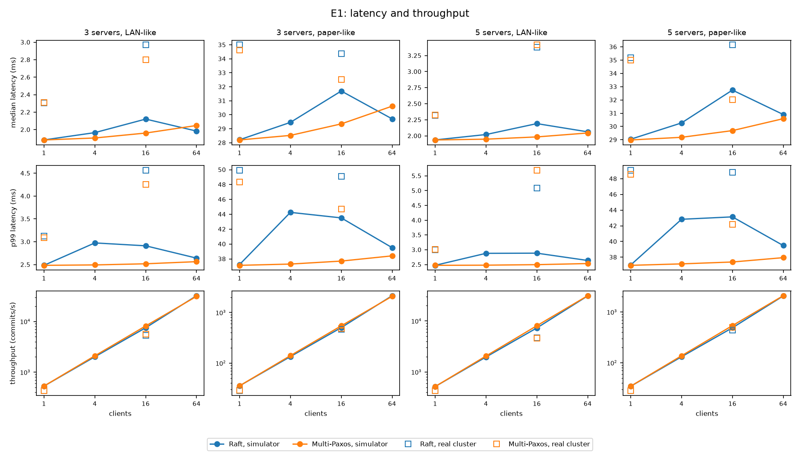
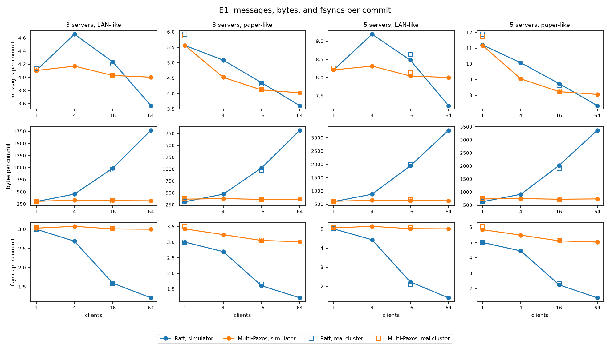
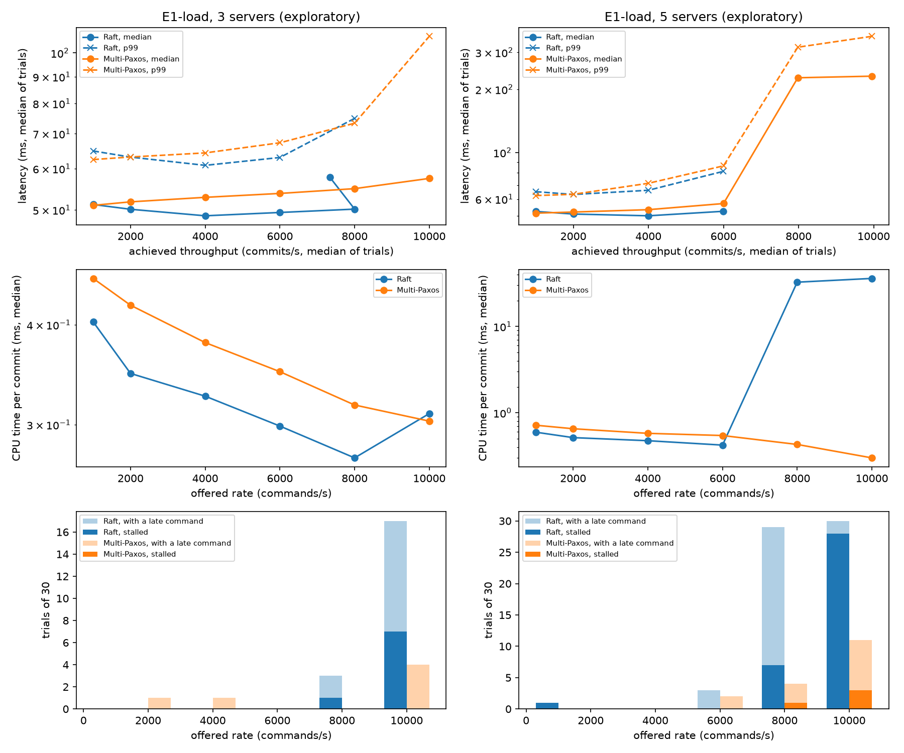
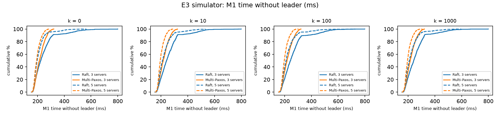
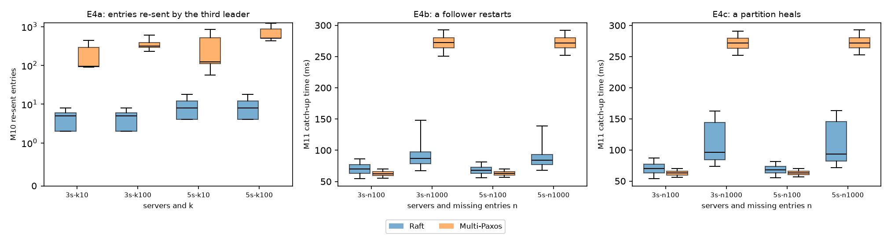
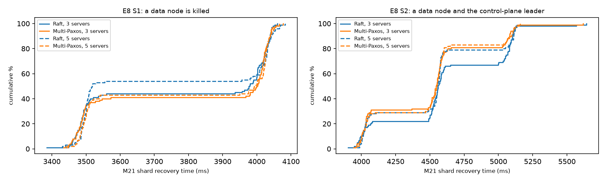

<!-- Status: complete. Every number comes from docs/RESULTS.md, and every figure from
cargo xtask figures (docs/figures/). -->

# Raft vs. Multi-Paxos on a Vector Store Control Plane

ECE 382N Distributed Systems, Fall 2026

Siddak Bhatia · Harrison Held

---

## The question

The Raft paper claims Raft is

1. **as efficient as Paxos**,
2. **decomposed**: leader election, log replication, and safety are separate, and
3. **more coherent**: fewer states to consider.

We test these claims by building the same system twice, once per algorithm, with the
algorithm as the only difference.

---

## Six research questions

| | Question | Hypothesis |
|---|---|---|
| RQ1 | Latency and throughput, stable leader | Equivalent within ±5% |
| RQ2 | Leader failure | Paxos election traffic grows with uncommitted entries |
| RQ3 | Entries re-sent by a new leader | Raft re-sends fewer |
| RQ4 | Coherency | Raft: fewer states, no gaps, nothing sent toward a leader |
| RQ5 | Implementation | Raft: fewer message types, lower complexity |
| RQ6 | Vector store recovery | Differs only if the control-plane leader also fails |

---

## The system

```
clients ──(shard map, admin)──▶ control plane: 3 or 5 servers
   │                             consensus: Raft | Multi-Paxos
   │ writes, searches                ▲
   ▼                                 │ heartbeats, leases, replica changes
data nodes: shard = primary + backups
```

- Only **metadata** goes through consensus: collections, data nodes, shard ownership.
- Vectors go straight to data nodes; each shard is replicated primary-to-backup with an
  in-sync set and epochs, as in Kafka.
- Leases (`L` = 3 s) guarantee **at most one serving primary**; the in-sync set
  guarantees **no lost acknowledged write**.

---

## One codebase, two algorithms

- One `Consensus` trait: no I/O, no clock, seeded randomness.
- Three drivers run the **same algorithm code**: a deterministic simulator, a model
  checker (Stateright), and the real server (gRPC, fsync).
- Only `crates/raft` and `crates/paxos` differ; messages, bytes, fsyncs, and timings are
  counted in shared code.
- `cargo xtask check-repo` enforces the separation.

---

## Our Multi-Paxos

Following Howard & Mortier: Paxos in Raft's terms, differing in **leader election**.

- Each term belongs to one server (`t mod N`).
- A candidate sends `Prepare` with its commit index; voters return every entry above it.
- The new leader keeps the highest-term entry per index, fills gaps with no-ops, and
  re-proposes everything in its own term.
- Followers accept each index on its own: **logs can have gaps**.

Same timers, batching, no-op on election, and leadership confirmation as Raft.
Frozen as a one-page spec before coding (`docs/PAXOS_SPEC.md`).

---

## Method: pre-registered

- Hypotheses, metrics, procedures, sample sizes, and tests fixed **before data**;
  changes only as dated amendments.
- Same `Config`, same seeds, same fault schedules for both algorithms.
- Same correctness bar: both must pass 10,000 random-fault seeds with zero violations
  before any measurement.
- A/A test (Raft vs. Raft) before any comparison, in the simulator and on the real cluster.
- Wilcoxon (paired), Mann–Whitney (unpaired), ±5% equivalence, Holm correction.
- 1,000 paired simulator trials and 100 real-cluster trials per configuration.

---

## Experiments

| | What | Where |
|---|---|---|
| E1 | Steady state: latency, throughput, cost per commit | sim + real |
| E1-load | Latency against offered load (exploratory) | real |
| E2 | Raft's Figure 16 (validation) | sim + real |
| E3 | Leader crash with `k` uncommitted entries | sim + real |
| E4 | Consecutive crashes; follower catch-up | sim |
| E5 | Partitions P1–P5 | sim + real |
| E6 | Model checking: reachable states | Stateright |
| E7 | Message types, code size, complexity, bugs | static analysis |
| E8 | Shard recovery after a data-node crash | real |

---

## Found during data collection

- An exploratory look at one E4 result (catch-up after a partition) didn't fit.
- Cause: after a reply, **each leader sent at most one message** of 64 entries, so a
  backlog moved one batch per round trip, not up to the 1,024-entry window.
- Raft needed about **16 round trips** to catch a follower up on 1,000 entries.
- Every checker passed: the bug cost only time.
- Protocol rule: fix it and **rerun everything** for both algorithms. The superseded run
  is kept and reported.
- The analysis later found a miscounted metric (re-sent entries); the three runs that
  measure it were rerun.

---

## Results: validation

- 10,000 random-fault seeds per algorithm, 166.7 simulated hours each: **0 violations**.
- A/A tests (Raft against Raft) pass in the simulator and on the real cluster.
- Figure 16: R1 passes; R2 fails at the shortest timeouts on the paper-like network
  (round trips exceed the timeouts), and holds on the LAN-like network.
- R1 rests on censored trials: at 150–150 ms, 55% elected no leader within 60 s. Without
  them (the pre-registered sensitivity analysis), R1 fails.

---

## Results at a glance

| Measure | Better |
|---|---|
| Speed, 1 or 64 commands in flight | neither (within ±5%) |
| Speed, 4–16 in flight | Multi-Paxos, up to 11% |
| Latency under a fixed load | Raft, by 1.1–4.8 ms, up to its limit |
| Highest sustained load; stalls | Multi-Paxos: ≥ 10,000/s against 6,000–8,000; 4 stalled trials against 44 |
| Storage syncs; CPU per commit (16 clients, under load) | Raft |
| Network bytes per commit | Multi-Paxos with 4+ in flight (Raft 2.7–5.6× at 16+) |
| Time without a leader | Multi-Paxos, 2–11% sooner |
| Flapping link; re-sent entries | Raft: 1–2 leader changes against 15; 15–64× fewer entries |
| Safety; shard recovery | neither: no violations; 3.4–5.6 s under both |
| Log gaps; code size | Raft |

---

## RQ1: Steady state, H1 not supported

| Commands in flight | Faster |
|---|---|
| 1 | neither |
| 4–16 | Multi-Paxos: at 16 clients, 7–10% lower latency and 8–11% higher throughput (simulator) |
| 64 | neither: Raft 3% faster on 3 servers, Multi-Paxos 1% on 5 |
| ~100 or more (load sweep) | Raft, until it stops keeping up |

- Every message has its own delay, so messages arrive out of order. Raft followers reject
  an `AppendEntries` whose predecessor is missing: about once per commit at 16 clients.
- Load sweep: Raft keeps up with 8,000 (3 servers) and 6,000 (5) commands per s;
  Multi-Paxos with at least 10,000. Raft stalled in 44 of 360 trials, Multi-Paxos in 4.

---

## RQ1: latency and throughput



---

## RQ1: what each commit costs

- **Storage:** Raft 1.2–2.3 syncs per commit at 16+ clients, Multi-Paxos 3.0–5.1.
- **CPU** (real cluster, 16 clients): Multi-Paxos 4–27% more per commit.
- **Network:** Raft 2.7–5.6× the bytes at 16+ clients; Multi-Paxos 2–21% more at 1.



---

## RQ1: under a fixed offered load (exploratory)



---

## RQ2: Leader failure and partitions

- **H2a:** Multi-Paxos's election traffic grows with uncommitted entries (bytes ×112–130):
  its promises carry them. Raft's grows too, but only through followers' replies to the
  crashed leader; on 3 servers its vote messages stay at 13 bytes.
- **H2b:** Multi-Paxos elects 2–11% sooner in the simulator; unavailability differs by less
  than 0.6%. On the real cluster it elects sooner with k = 100 (p (Holm) 0.041 and 0.035),
  with no significant difference at k = 0.
- **Flapping link (P5):** over the 10 s of flapping and the 3 s after, Multi-Paxos changed
  leaders 15 times (median), Raft 1–2.
  - The cut-off follower stood 314 times under Multi-Paxos and won all 314.
  - Under Raft it stood 101 times and won none: voters refused its stale log.

---

## RQ2: time without a leader



Raft's tail is longer: more than one election round in 31–39% of failovers, against
10–18% for Multi-Paxos.

---

## RQ3: Re-sent entries and catch-up, H3 supported

| | Raft | Multi-Paxos |
|---|---|---|
| Entries re-sent by a new leader (E4a, median) | 5–8 | 96–510 |
| Catch-up of 1,000 missing entries | 84–96 ms | 272 ms |
| Catch-up of 100 missing entries | 68–70 ms | 63 ms |

- 15–64 times fewer re-sent entries in every configuration: a Raft leader already holds
  every committed entry; a Multi-Paxos leader re-proposes everything it inherits.
- A Raft leader pipelines up to 1,024 entries to a matching follower; Multi-Paxos sends
  missing chosen entries 64 at a time, one message unanswered.

---

## RQ3: re-sent entries and catch-up



---

## RQ4: Coherency, H4 partly supported

- **Log gaps:** none for Raft in 29,000 trials; every Multi-Paxos trial had some.
- **Reachable states:** at the one rung both completed, Multi-Paxos reached 3.7% fewer
  (35.8 M against 37.1 M). Two larger rungs exceeded the budget; the rest were skipped.
- **Entries toward a leader:** non-zero for Raft, but 95% are a new leader's
  `AppendEntries` reaching a same-term candidate: the metric, not the data flow.

---

## RQ5: Implementation

| | Raft | Multi-Paxos |
|---|---|---|
| Message types | 4 | 5 |
| SLOC | 860 | 1,008 |
| Cyclomatic / cognitive | 123 / 62 | 139 / 68 |
| Largest gap | election: 128 against 183 SLOC | |

---

## RQ6: Vector store recovery, H6 not supported

- 800 trials: **0 lost writes, never two serving primaries.**
- Recovery took 3.4–5.6 s, dominated by the lease (3 s + 0.5 s margin).
- Data node alone: intervals too wide for equivalence. With the control-plane leader: no
  difference detected (medians within 0.3%).



---

## Demo: live failover

`cargo xtask demo --consensus raft` (or `paxos`):

1. 3 control-plane servers, 4 data nodes, 20,000 GloVe-25 vectors, 4 writers.
2. `kill -9` the control-plane leader: a new leader is elected and writes continue.
3. `kill -9` the primary of shard 0: after its lease expires, a backup is promoted at a
   new epoch, and re-replication restores 3 in-sync copies.
4. A search, then the checks: no acknowledged write lost, never two serving primaries.

---

## Threats to validity

- **Our** Multi-Paxos variant, built close to Raft; optimizations off in both.
- Same two authors; Raft written first.
- Not matched with Raft: Multi-Paxos heartbeats resend unacknowledged entries, and its
  followers rewrite entries they hold; both can add syncs and bytes (amount not measured).
- Simulator and localhost, not real networks; one machine, one SSD; `fsync(2)`.
- Environment not recorded per trial (no core pinning, load, or timestamps); the shuffled
  order and the A/A tests bound the noise.
- E1–E5 send a 128-byte command that changes nothing; CPU and memory measured only in
  steady state and the load sweep.
- Code complexity stands in for understandability.
- Exploratory analyses are labeled and never decide a hypothesis.

---

## Conclusion

- **Efficiency:** equivalent with 1, 4, and 64 commands in flight; Multi-Paxos up to 11%
  faster with 16, on a network that reorders messages. Raft syncs storage less often and
  uses less CPU per commit under load, but with many commands in flight sends far more
  bytes, and it stops keeping up sooner.
- **Leader failure:** Raft re-sends far fewer entries; Multi-Paxos elects 2–11% sooner;
  Raft's election restriction keeps it stable on a flapping link.
- **Coherency:** Raft's logs never have gaps; at the one bound both searches completed,
  Multi-Paxos reached 3.7% fewer states.
- **Implementation:** Raft is smaller on every code measure.
- **Vector store:** recovery is set by the lease under both algorithms.

---

# Questions

Code, protocol, raw results, and analysis:
`docs/REPORT.md` · `docs/RESEARCH.md` · `experiments/results/`
